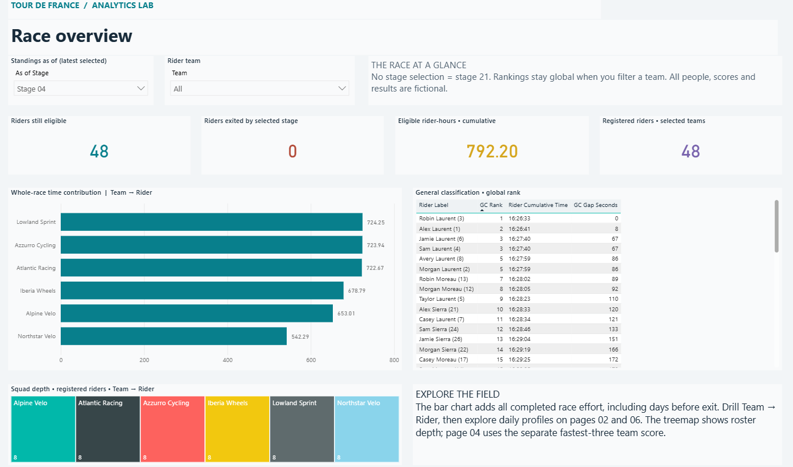
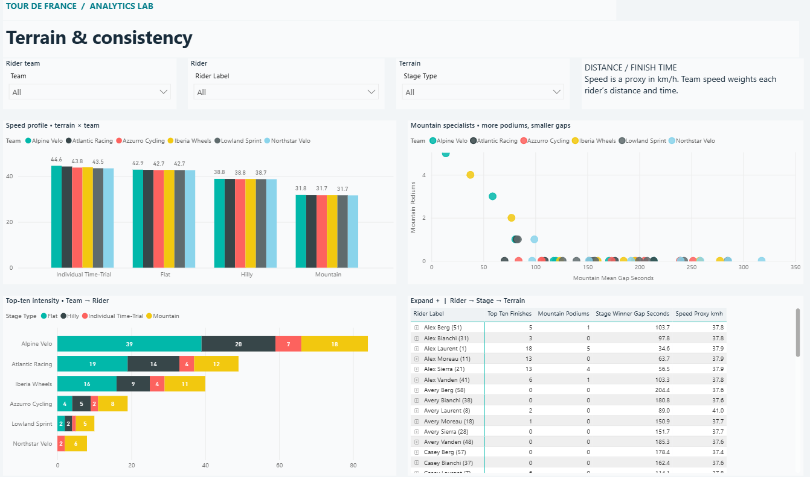
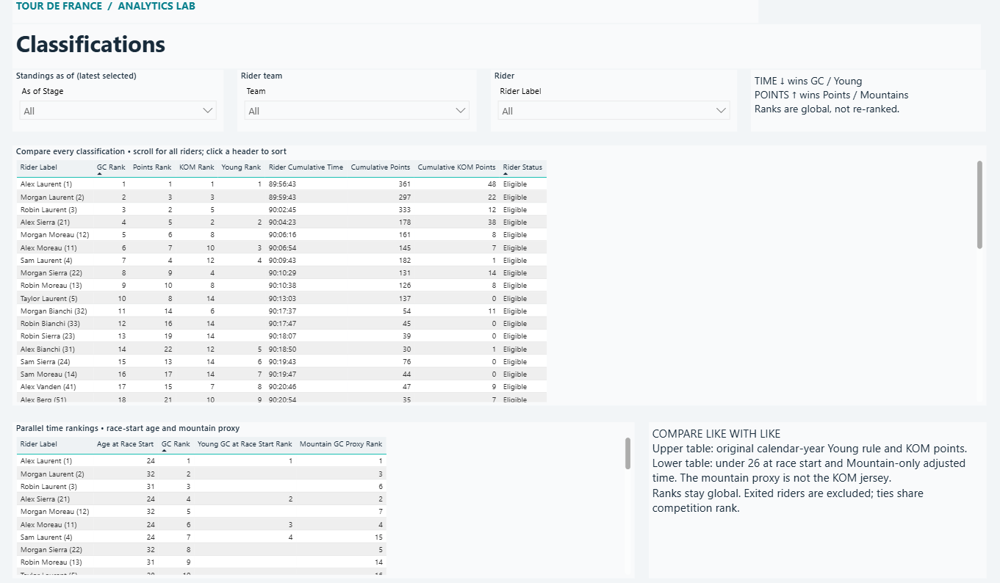
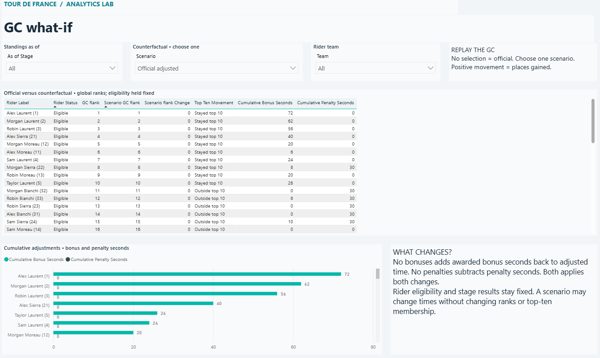

# Tour de France Analytics Dashboard

An interactive Power BI dashboard exploring fictional Tour de France race data through stage analysis, rider and team performance, classifications and what-if scenarios.

Built with **Power BI Desktop**, using a reproducible data-generation pipeline, a TMDL semantic model and a native PBIR report.

> **Note:** All data is fictional. This is a reproducible demonstration, not an analysis of actual Tour de France results.

## Dashboard Preview



*Race overview showing overall race and team performance.*



*Explore rider performance across terrain types*



*Compare global rankings and rider eligibility across stages.*



*Explore general classification scenarios.*

## Dashboard Pages

The report contains ten pages:

| Page | Focus |
|---|---|
| Race Overview | Overall race and team performance |
| Stage Explorer | Stage, team and rider analysis |
| Classifications | Four global rankings |
| Team Performance | Team results across stages |
| Country Participation | Rider nationality and team representation |
| GC Storyline | Changes in general classification |
| Terrain & Consistency | Performance across terrain types |
| Routes & Stage Focus | Route characteristics and stage details |
| GC What-If | General classification scenarios |
| Guide & Definitions | Report controls and calculation assumptions |

## Interactive Features

A few examples of what you can explore:

- **Drill-down:** Move from teams to individual riders in the Race Overview.
- **Stage analysis:** Expand the Stage Explorer matrix across stages, teams and riders.
- **Rider eligibility:** Track classification changes as riders exit the race.
- **Team scoring:** Compare team performance while accounting for minimum finisher requirements.
- **Country participation:** Explore team representation and rider nationality, including countries with zero participation.

Slicers and cross-filtering allow you to explore the report dynamically. Page 10 explains the controls and scoring assumptions.

## Technical Implementation

**Tech stack:** Power BI Desktop, DAX, Power Query M, TMDL, PBIR, Python and JavaScript (Node.js).

| Component | Purpose |
|---|---|
| `data/` | CSV fixtures, scoring extensions and model inputs |
| `tools/generate_data.py` | Deterministic data generation using seed 5110 |
| `tools/build_model.mjs` | Builds and exports the semantic model |
| `tools/build_report.mjs` | Generates the ten-page PBIR report |
| `tests/` | Data tests and independently calculated expected results |
| `tools/test_dax.mjs` | Tests calculations against the Power BI Desktop engine |
| `tools/test_visual_queries.mjs` | Validates report visual queries |
| `docs/` | Calculation definitions and requirement traceability |
| `review/` | Test results, screenshots and independent reviews |

## Reproducing the Project

### Requirements

- Python 3.11+
- Node.js 22+
- Power BI Desktop
- npm

From the repository root:

```powershell
python task3/tools/generate_data.py
python task3/tests/test_data.py
python task3/tools/run_checks.py

Push-Location task3/tools
npm ci
Pop-Location

node task3/tools/build_report.mjs
node task3/tools/validate_report.mjs
```

To rebuild the semantic model, open a **new blank Power BI Desktop file**, obtain its local port through MCP `connection_operations / ListLocalInstances`, and run:

```powershell
node task3/tools/build_model.mjs 'Data Source=localhost:PORT'
```

Open `task3/Tour de France.pbip` in Power BI Desktop. Keep the `.Report` and `.SemanticModel` directories alongside it. If visuals appear empty initially, select **Home → Refresh**.

The project uses embedded dummy data and requires no external dataset credentials. Editing the CSV files alone does not update an existing report; rebuild the model to apply changes.

The editable source deliverable is the **PBIP/TMDL/PBIR project**. A packaged `.pbix` can be saved through Power BI Desktop if needed.

---

